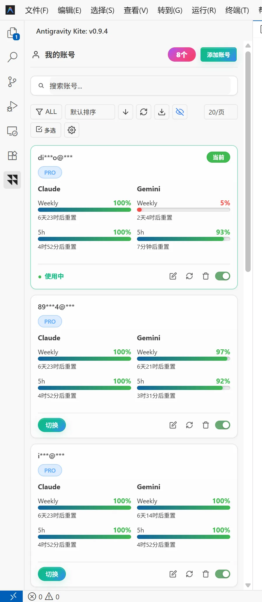

<div align="center">

# 🪁 Antigravity Kite

### Antigravity 多账号无感切号与号池管理扩展

**切号不重启 IDE · Claude / Gemini / Gemini 4 真实双窗配额流 · 安全声明自动确认 · 中英双语自适应**

[](https://github.com/soulvon/Antigravity-Kite/releases/latest)
[](LICENSE)
[]()
[](https://github.com/soulvon/Antigravity-Kite/releases)
[](https://open-vsx.org/extension/soulvon/antigravity-kite)

[English](README_en.md) • [简体中文](README.md)

[📥 下载安装](#-下载与安装) •
[🖼️ 界面预览](#️-界面预览) •
[⚡ 解决什么问题](#-它解决什么问题) •
[✨ 核心能力](#-核心能力) •
[⚙️ 配置说明](#️-配置说明) •
[❓ 常见问题 FAQ](#-常见问题-faq) •
[🧰 同系列作品](#-同系列作品)

<br>

**无需退出登录、无需重启 IDE，侧栏一点即切。**

Antigravity Kite 是一款面向 **Antigravity IDE** 的多账号管理与无感切号扩展。内置号池托管、**Claude / Gemini 双模型各自的 5h 窗与周窗官方配额**（带重置倒计时）、安全声明自动确认与 Google OAuth 快捷登录，界面中英双语自适应。

</div>

---

## 🖼️ 界面预览

侧栏账号卡片流：**Claude / Gemini / Gemini 4 单列竖排配额条**（周额度 + 5h 短窗，百分比与重置倒计时实时可视，无空位冗余），当前账号高亮，启停开关、编辑、刷新、删除一应俱全：

<div align="center">
  
</div>

---

## 📥 下载与安装

### 方式一：扩展面板安装（推荐）

1. 下载最新版 `antigravity-kite-1.1.7.vsix`（[GitHub Releases](https://github.com/soulvon/Antigravity-Kite/releases/latest)）；
2. 打开 **Antigravity IDE**；
3. 进入左侧扩展面板（快捷键 `Ctrl+Shift+X` / macOS `Cmd+Shift+X`）；
4. 点击面板右上角 `...` 菜单 ➔ 选择 **"从 VSIX 安装..." (Install from VSIX...)**；
5. 安装完成后左侧活动栏即可看到 **Kite 风筝图标**。

### 方式二：命令行安装

```bash
antigravity-ide --install-extension antigravity-kite-1.1.7.vsix --force
```

---

## ⚡ 它解决什么问题

| 你遇到的问题 | 默认情况 / 手动处理 | Antigravity Kite 的处理方式 |
| :--- | :--- | :--- |
| **配额耗尽换号麻烦** | 官方换号要退出登录、重新走一遍 OAuth，IDE 还得重启 | **无感切号**：侧栏一点，凭证后台静默重载，不退出、不重启 |
| **切号弹安全声明** | 每次切换都要手动点一次 "Security Notice & Data Use" | **声明自动确认**：CDP 心跳自动关闭弹窗，切号全程零打断 |
| **配额还剩多少、何时重置** | 官方只给个模糊百分比，5h 窗和周窗混在一起 | **双模型双窗口真数据**：Claude / Gemini 各自的 5h 窗与周窗独立进度条 + 精确到小时的重置倒计时 |
| **Gemini 登录态不同步** | 切号后 Gemini 侧仍是上个账号的凭证 | **凭证文件同步**：切号自动同步 `~/.gemini` 的 OAuth 凭证与账号文件（可关） |
| **多账号管理混乱** | 账号散落在浏览器与配置文件里 | **号池托管**：卡片流管理、标签搜索、批量操作、多窗口实时同步 |
| **界面语言不跟手** | 英文界面硬啃 | **中英双语自适应**：默认跟随 IDE 语言，也可在设置中锁定 |

---

## ✨ 核心能力

### 🔄 1. 无感切号
- **一点即切**：侧栏卡片「切换」按钮或启停开关旁一键换号，凭证后台静默重载，**不退出、不重启 IDE**；
- **强制刷新 Token**：切号前自动刷新 OAuth 凭证，杜绝带着过期 Token 切换；
- **切换加载态与 Toast 反馈**：切号过程可视，成功失败都有明确提示。

### 📊 2. Claude / Gemini 双模型双窗口配额
- **官方窗口级真数据**：直读官方配额摘要接口，Claude 与 Gemini 各自独立的 **5h 短窗**与 **Weekly 周窗**进度条；
- **重置倒计时**：每个窗口精确显示"X 天 X 时 / X 时 X 分后重置"；
- **一键全额刷新**：顶部一键并行拉取全部账号的实时配额；
- **OAuth 自动续期**：查询配额或切号前自动静默刷新 Token，会话永远在线；
- **版本兼容降级**：Antigravity IDE ≥ 2.25.0 提供完整双窗数据，旧版本自动降级为估算口径。

### 🛡️ 3. 安全声明自动确认（CDP 门控）
- **心跳自动关弹窗**：IDE 以调试端口启动时，后台心跳自动确认 "Security Notice & Data Use"，切号零打断；
- **一次性引导**：首次切号时引导开启调试端口（自动修改快捷方式并重启 IDE，仅此一次）；
- **无端口兜底**：未开调试端口时每次切换弹一次声明，手动点击即可，功能不受影响；
- **心跳频率可调**：设置中可调整心跳间隔，弹窗关闭速度与 CPU 占用自平衡。

### 🗂️ 4. 号池管理
- **卡片流管理**：当前账号高亮徽章、PRO 套餐标识、启停开关、编辑、刷新、删除一应俱全；
- **标签与搜索**：自定义标签分组，顶栏模糊搜索秒定位；
- **批量操作**：多选模式支持批量导出、批量打标签、批量删除；
- **排序与分页**：默认排序可切换，每页 20 条分页加载，号池再多也不卡；
- **多窗口实时同步**：号池落盘共享文件，多窗口免重启实时跟随。

### 📥 5. 多通道导入
- **Google OAuth 登录**：唤起浏览器一键授权入池；
- **提取当前会话**：把 IDE 当前登录的账号直接收进号池；
- **生态互通**：与 Cockpit Tools、Antigravity Manager 的号池数据互通，另支持 JSON 文件导入。

### 🔐 6. 凭证安全与 Gemini 同步
- **系统级安全存储**：Windows 下接入凭据管理器（Credential Manager），敏感信息不落明文；
- **隐私脱敏**：邮箱与 UID 星号掩蔽，直播录屏无忧；
- **Gemini 凭证同步**：切号时自动同步 `~/.gemini` 的 `oauth_creds.json` 与 `google_accounts.json`（与 AgyHop / Cockpit 等工具共管时可关闭）。

### 🌐 7. 双语自适应与统计面板
- **中英双语**：默认跟随 IDE 语言自动切换，设置中可锁定中文或英文；
- **统计面板**：`Ctrl+Shift+Q` 打开统计面板，运行状态一目了然；
- **自动更新**：启动静默检查 GitHub 最新版本，发现新版可自动安装。

---

## 🚀 快速上手（三步）

```
[添加账号] ──► [填满额度条] ──► [一键切换]
```

1. 打开侧栏 **Antigravity Kite** 面板（活动栏风筝图标）；
2. 通过 **Google 登录**、**提取当前会话**或**批量 Token** 向号池添加账号；
3. 点击任意卡片底部的 **切换** 按钮，无感换号完成。

---

## ⚙️ 配置说明

在 IDE 设置中搜索 `antigravityKite`：

| 配置项 | 默认值 | 说明 |
| :--- | :--- | :--- |
| `antigravityKite.locale` | `auto` | 界面与提示文案语言：auto 跟随 IDE 语言 / zh / en |
| `antigravityKite.autoConfirmDeclaration` | `false` | 切号时自动确认安全声明（需调试端口，首次切号引导开启） |
| `antigravityKite.cdpPort` | `9222` | 调试端口，9222 会作为兜底自动尝试 |
| `antigravityKite.cdpHeartbeatMs` | `2000` | 声明自动确认的心跳间隔（毫秒），改动即时生效 |
| `antigravityKite.quotaRefreshMinutes` | `15` | 后台刷新全部账号配额的间隔（分钟），重启 IDE 后生效 |
| `antigravityKite.switch.syncGeminiFiles` | `true` | 切号时同步 `~/.gemini` 凭证文件（多工具共管时可关闭） |
| `antigravityKite.update.autoCheck` | `true` | 启动时自动检查更新 |
| `antigravityKite.update.autoInstall` | `false` | 发现新版本时自动静默安装 |

---

## ⌨️ 快捷键

| 快捷键 | 对应动作 |
| :--- | :--- |
| `Ctrl+Shift+Q`（macOS `Cmd+Shift+Q`） | 打开统计面板 |

---

## 🖥️ 兼容性

- **Windows / macOS / Linux**；
- **Antigravity IDE 2.x** —— ≥ 2.25.0 提供 Claude / Gemini 完整双窗配额，旧版本自动降级估算。

---

## ❓ 常见问题 FAQ

<details>
<summary><b>Q1: 切换账号需要重启 IDE 吗？</b></summary>
<br>
<b>不需要。</b>Kite 通过后台静默重载凭证完成无感切换，正在编辑的文件与 AI 会话均不受影响。
</details>

<details>
<summary><b>Q2: 切号时为什么会有安全声明弹窗？</b></summary>
<br>
这是 Antigravity 官方的 "Security Notice & Data Use" 确认。开启调试端口后 Kite 会以心跳自动确认（首次切号引导开启，仅此一次）；未开端口时每次切换手动点一次即可。
</details>

<details>
<summary><b>Q3: 配额进度条是官方数据吗？</b></summary>
<br>
<b>是。</b>直读官方窗口级配额摘要接口，Claude 与 Gemini 各自独立的 5h 窗与周窗为真实数据；IDE ≥ 2.25.0 数据最完整，旧版本自动降级为估算口径。
</details>

<details>
<summary><b>Q4: 我还在用 AgyHop / Cockpit，凭证文件会冲突吗？</b></summary>
<br>
切号时 Kite 默认同步 <code>~/.gemini</code> 的凭证文件。如果你有其它工具也在管理这些文件，可在设置中关闭 <code>syncGeminiFiles</code>，两者互不干扰。
</details>

<details>
<summary><b>Q5: 账号 Token 存在哪里，安全吗？</b></summary>
<br>
全部凭证仅保存在本地（Windows 接入系统凭据管理器），无任何遥测与第三方上传，界面支持一键脱敏。
</details>

---

## 🧰 同系列作品（同一作者的 AI 工具箱）

| 项目 | 简介 | 适合谁 |
| :--- | :--- | :--- |
| [🚀 **AnyBridge**](https://github.com/soulvon/AnyBridge)  | BYOK 模型接入工作台：统一管理 16+ AI 编程智能体（Cursor / Windsurf / Devin / Claude Code / Codex / CodeBuddy 等）的模型渠道，本地代理接管 + 配置直写，支持第三方中转站与本地聚合网关 | 想给封闭 IDE 接自定义模型的人 |
| [🪁 **Kite**](https://github.com/soulvon/Kite)  | Windsurf / Devin 多账号号池与 AI IDE 增强套件：多账号共享号池、额度监控、额度耗尽自动切换、多实例分身、界面增强 | Windsurf / Devin 重度用户 |
| [🎫 **BuddyRelay**](https://github.com/soulvon/BuddyRelay)  | CodeBuddy / WorkBuddy 多账号切换 VS Code 插件：多窗口号池同步、额度流水对账、探针预检与自动切号，已上架 Open VSX 商店 | CodeBuddy / WorkBuddy 用户 |
| [🔍 **devin-search-mcp**](https://github.com/soulvon/devin-search-mcp)  | 把 Devin 原生全网实时搜索与网页正文提取抽成标准 MCP：1 秒级响应、零模型额度消耗，`npx -y devin-search-mcp` 直装 | Cursor / Claude Code / Claude Desktop / CodeBuddy 用户 |

> 全部开源 · 本地优先 · 持续维护 —— 前往 [作者主页](https://github.com/soulvon) 查看全部项目。

---

## 🤝 参与贡献与问题反馈

- 🐛 **发现 Bug** → [提交 Issue](https://github.com/soulvon/Antigravity-Kite/issues)
- 💡 **功能建议** → [提交 Feature Request](https://github.com/soulvon/Antigravity-Kite/issues/new/choose) 或参与 [Discussions 讨论](https://github.com/soulvon/Antigravity-Kite/discussions)

---

---

## ⭐ Star History

**如果这个工具帮到了你，点一个 Star 让更多开发者看到它 · If this project helps you, a star means a lot.**

[](https://star-history.com/#soulvon/soulvon/Antigravity-Kite&Date)

---

## 📄 开源许可证

本项目基于 [MIT License](LICENSE) 开源发布。
