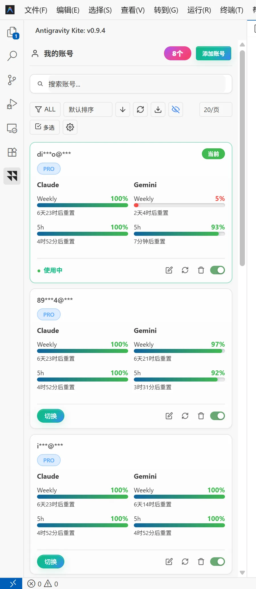

<div align="center">

# 🪁 Antigravity Kite

### Seamless multi-account switching & account pool management for Antigravity IDE

**Switch without restart · Dual-model dual-window real quotas (Claude / Gemini) · Auto-confirm security notice · Bilingual UI**

[](https://github.com/soulvon/Antigravity-Kite/releases/latest)
[](LICENSE)
[]()
[](https://github.com/soulvon/Antigravity-Kite/releases)
[](https://open-vsx.org/extension/soulvon/antigravity-kite)

[English](README_en.md) • [简体中文](README.md)

[📥 Install](#-install) •
[🖼️ Preview](#️-preview) •
[⚡ What it solves](#-what-it-solves) •
[✨ Core Features](#-core-features) •
[⚙️ Settings](#️-settings) •
[❓ FAQ](#-faq) •
[🧰 More tools](#-more-tools-from-the-same-author)

<br>

**One click in the sidebar — no sign-out, no IDE restart.**

Antigravity Kite is a multi-account manager and seamless switcher for the **Antigravity IDE**. It ships with an account pool, **official per-model 5h & weekly quotas for Claude / Gemini** (with reset countdowns), automatic confirmation of the security notice, and a bilingual (EN/ZH) adaptive UI.

</div>

---

## 🖼️ Preview

Sidebar account card flow: **dual-column quota bars for Claude & Gemini** (weekly + 5h windows, live percentages and reset countdowns), current account highlighted, with toggle, edit, refresh and delete at hand:

<div align="center">
  
</div>

---

## 📥 Install

### Option 1: Extensions panel (recommended)

1. Download the latest `antigravity-kite-1.0.3.vsix` ([GitHub Releases](https://github.com/soulvon/Antigravity-Kite/releases/latest));
2. Open the **Antigravity IDE**;
3. Open the Extensions view (`Ctrl+Shift+X` / macOS `Cmd+Shift+X`);
4. Click the `...` menu ➔ **"Install from VSIX..."**;
5. After install, the **Kite icon** appears in the activity bar.

### Option 2: Command line

```bash
antigravity-ide --install-extension antigravity-kite-1.0.3.vsix --force
```

---

## ⚡ What it solves

| Pain | Default / manual | With Antigravity Kite |
| :--- | :--- | :--- |
| **Exhausted quota, painful switching** | Sign out, redo OAuth, restart the IDE | **Seamless switch**: one click reloads credentials in the background — no sign-out, no restart |
| **Security notice on every switch** | Click "Security Notice & Data Use" manually each time | **Auto-confirm**: a CDP heartbeat closes the dialog — zero interruptions |
| **Quota left & reset time unknown** | Vague percentages, 5h and weekly windows mixed up | **Dual-model dual-window real data**: independent 5h & weekly bars for Claude / Gemini, with hour-level reset countdowns |
| **Gemini session not switching** | Gemini side keeps the previous account's credentials | **Credential sync**: `~/.gemini` OAuth & account files synced on switch (optional) |
| **Messy account management** | Accounts scattered across browsers and config files | **Account pool**: card flow, tags & search, batch actions, real-time cross-window sync |
| **English-only UI** | Struggle through menus | **Bilingual EN/ZH**: follows the IDE language by default, lockable in settings |

---

## ✨ Core Features

### 🔄 1. Seamless switching
- **One-click switch**: reloads credentials silently in the background — **no sign-out, no IDE restart**;
- **Forced token refresh**: OAuth credentials are refreshed before switching, no stale tokens;
- **Visible progress**: loading state on switch, toast on success or failure.

### 📊 2. Dual-model dual-window quotas (Claude / Gemini)
- **Official window-level data**: reads the official quota summary — independent **5h** and **weekly** windows per model family;
- **Reset countdowns**: "resets in X d X h / X h X min" for every window;
- **Refresh all**: one click refreshes quotas for every account in parallel;
- **OAuth auto-renewal**: tokens refresh silently before quota queries and switches;
- **Graceful fallback**: full dual-window data on Antigravity IDE ≥ 2.25.0; older versions fall back to estimates.

### 🛡️ 3. Auto-confirm security notice (CDP gate)
- **Heartbeat auto-confirm**: when the IDE runs with a debug port, a heartbeat closes the "Security Notice & Data Use" dialog automatically;
- **One-time setup**: the first switch offers to enable the debug port (patches shortcuts and restarts the IDE once);
- **Fallback**: without a debug port the notice appears once per switch for a manual click — nothing breaks;
- **Tunable heartbeat**: adjust the interval in settings to balance dialog speed and CPU.

### 🗂️ 4. Account pool management
- **Card flow**: current-account badge, PRO tier chip, enable/disable toggle, edit, refresh and delete;
- **Tags & search**: custom tag groups, fuzzy search in the top bar;
- **Batch actions**: multi-select with batch export, batch tagging and batch delete;
- **Sort & pagination**: switchable sort, 20 cards per page — smooth even with a large pool;
- **Cross-window sync**: the pool lives in a shared file; all windows follow in real time.

### 📥 5. Multi-channel import
- **Google OAuth**: authorize in the browser and add to the pool in one step;
- **Extract current session**: pull the currently logged-in account into the pool;
- **Ecosystem**: interops with Cockpit Tools and Antigravity Manager pools, plus JSON file import.

### 🔐 6. Credential safety & Gemini sync
- **System-grade storage**: integrates the Windows Credential Manager — no plaintext secrets;
- **Privacy masking**: emails and UIDs are masked on screen, safe for streaming;
- **Gemini sync**: `~/.gemini` `oauth_creds.json` and `google_accounts.json` are synced on switch (disable if tools like AgyHop / Cockpit also manage them).

### 🌐 7. Bilingual UI & stats panel
- **EN / ZH**: follows the IDE language automatically; lock to Chinese or English in settings;
- **Stats panel**: `Ctrl+Shift+Q` opens the stats panel;
- **Auto-update**: silently checks GitHub releases on startup and can auto-install.

---

## 🚀 Quick start (3 steps)

```
[Add accounts] ──► [Watch quota bars] ──► [Switch in one click]
```

1. Open the **Antigravity Kite** panel (kite icon in the activity bar);
2. Add accounts via **Google login**, **current-session extraction** or **bulk tokens**;
3. Hit **Switch** on any card — done, seamlessly.

---

## ⚙️ Settings

Search for `antigravityKite` in the IDE settings:

| Setting | Default | Description |
| :--- | :--- | :--- |
| `antigravityKite.locale` | `auto` | UI language: auto (follow IDE) / zh / en |
| `antigravityKite.autoConfirmDeclaration` | `false` | Auto-confirm the security notice on switch (requires a debug port; first switch offers to enable it) |
| `antigravityKite.cdpPort` | `9222` | Debug port; 9222 is tried as an automatic fallback |
| `antigravityKite.cdpHeartbeatMs` | `2000` | Heartbeat interval (ms) for auto-confirming the notice; takes effect immediately |
| `antigravityKite.quotaRefreshMinutes` | `15` | Background refresh interval (minutes) for all account quotas |
| `antigravityKite.switch.syncGeminiFiles` | `true` | Sync `~/.gemini` credential files on switch |
| `antigravityKite.update.autoCheck` | `true` | Check for updates on startup |
| `antigravityKite.update.autoInstall` | `false` | Silently install new versions when found |

---

## ⌨️ Keybinding

| Key | Action |
| :--- | :--- |
| `Ctrl+Shift+Q` (macOS `Cmd+Shift+Q`) | Open the stats panel |

---

## 🖥️ Compatibility

- **Windows / macOS / Linux**;
- **Antigravity IDE 2.x** — full Claude / Gemini dual-window quotas on ≥ 2.25.0; older versions fall back to estimates.

---

## ❓ FAQ

<details>
<summary><b>Q1: Do I need to restart the IDE to switch accounts?</b></summary>
<br>
<b>No.</b> Kite reloads credentials silently in the background — open editors and AI conversations are untouched.
</details>

<details>
<summary><b>Q2: Why does a security notice appear on switch?</b></summary>
<br>
That is Antigravity's official "Security Notice & Data Use" confirmation. With a debug port enabled, Kite auto-confirms it via a heartbeat (one-time setup on first switch); without one, click it manually once per switch.
</details>

<details>
<summary><b>Q3: Are the quota bars official data?</b></summary>
<br>
<b>Yes.</b> They read the official window-level quota summary — independent 5h and weekly windows for Claude and Gemini are real data; IDE ≥ 2.25.0 gives the most complete picture, older versions fall back to estimates.
</details>

<details>
<summary><b>Q4: I also use AgyHop / Cockpit — will credential files conflict?</b></summary>
<br>
Kite syncs <code>~/.gemini</code> credential files on switch by default. If other tools manage them too, turn off <code>syncGeminiFiles</code> in settings and the two won't interfere.
</details>

<details>
<summary><b>Q5: Where are tokens stored? Is it safe?</b></summary>
<br>
All credentials stay on your machine (Windows Credential Manager integration) — no telemetry, no third-party uploads, with one-click on-screen masking.
</details>

---

## 🧰 More tools from the same author

| Project | What it does | For whom |
| :--- | :--- | :--- |
| [🚀 **AnyBridge**](https://github.com/soulvon/AnyBridge)  | Unified BYOK model access for 16+ AI coding agents (Cursor / Windsurf / Devin / Claude Code / Codex / CodeBuddy…): local proxy takeover + config writing, relay-friendly | Give closed IDEs your own models |
| [🪁 **Kite**](https://github.com/soulvon/Kite)  | Multi-account pool & AI IDE enhancement suite for Windsurf / Devin: shared pool, quota monitoring, auto-switch, multi-instance | Heavy Windsurf / Devin users |
| [🎫 **BuddyRelay**](https://github.com/soulvon/BuddyRelay)  | Multi-account switcher extension for CodeBuddy / WorkBuddy: cross-window pool sync, usage ledger, probe pre-check & auto-switch. Available on Open VSX | CodeBuddy / WorkBuddy users |
| [🔍 **devin-search-mcp**](https://github.com/soulvon/devin-search-mcp)  | Exposes Devin's native real-time web search & clean page extraction as a standard MCP: ~1s response, zero LLM quota, install via `npx -y devin-search-mcp` | Cursor / Claude Code / Claude Desktop / CodeBuddy users |

> All open source · local-first · actively maintained — see the [author profile](https://github.com/soulvon) for all projects.

---

## 🤝 Contributing & Feedback

- 🐛 **Found a bug** → [Open an issue](https://github.com/soulvon/Antigravity-Kite/issues)
- 💡 **Feature idea** → [Feature request](https://github.com/soulvon/Antigravity-Kite/issues/new/choose) or [Discussions](https://github.com/soulvon/Antigravity-Kite/discussions)

---

---

## ⭐ Star History

**如果这个工具帮到了你，点一个 Star 让更多开发者看到它 · If this project helps you, a star means a lot.**

[](https://star-history.com/#soulvon/soulvon/Antigravity-Kite&Date)

---

## 📄 License

Released under the [MIT License](LICENSE).
